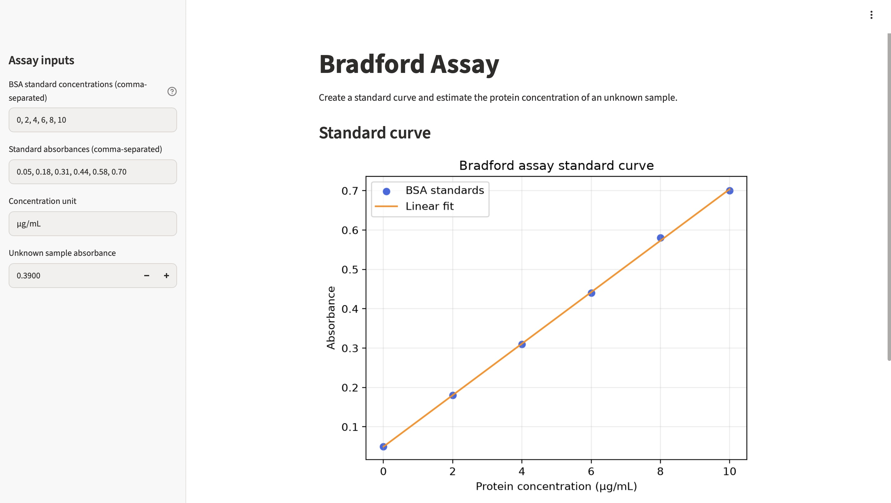
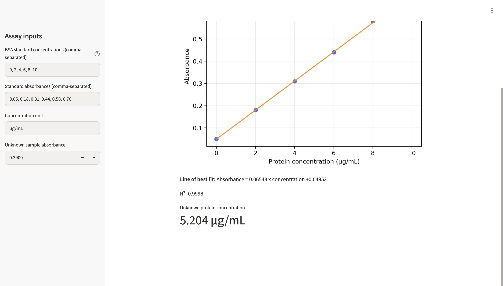

Bradford assay app
It is a web app to calculate protein concentration using Bradford Assay standard curve. 
This app automates the linear regression math used in standard biochemical protocols to quantify unknown protein sample. !

Start Screen:

Results Screen:

Another Result:
![Another Result][screenshot3.jpeg]

